<a href="https://samuele95.github.io/enigmista/">
  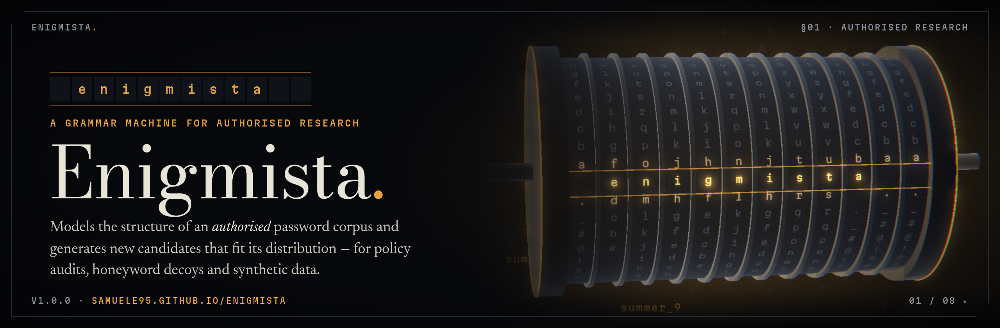
</a>

<p align="center">
  <a href="https://samuele95.github.io/enigmista/"></a>
  <a href="https://github.com/Samuele95/enigmista/releases/latest"></a>
  <a href="https://github.com/Samuele95/enigmista/actions/workflows/deploy.yml"></a>
  
</p>

<p align="center"><b>A neurosymbolic grammar machine for authorised password research,</b><br>
and the cinematic site that explains it.</p>

---

**Enigmista** models the structure of a password corpus you are **authorised** to analyse, and generates new, previously-unseen candidates that fit its distribution. Uses: password-policy audits, honeyword and decoy generation, synthetic data, and research. A language model induces a probabilistic grammar from a seed corpus. A symbolic sampler draws candidates from it. A scorer measures how well they cover a **frozen held-out split**, and the loop refines the grammar until coverage plateaus or hits its target.

This repository holds the **website**: a single immersive WebGL page built around *the Rotor*, a twelve-disc cryptex that dials every caption it shows. The skill itself ships as a [release](https://github.com/Samuele95/enigmista/releases/latest).

> [!IMPORTANT]
> **Authorised, defensive use only.** Enigmista works from a corpus you are authorised to use: your own policy audit, a research corpus, honeywords, synthetic data. It is not a password cracker. It never uses a named person's details to guess their passwords, and never targets anyone's accounts. Asked to, it names the boundary, offers the legitimate version, and stops. The corpus boundary is the whole difference between modelling a population and attacking a person, so the site puts it in a full chapter of its own, not a footer.

## Get Enigmista

| | |
|---|---|
| **The skill** (Claude Code; the same loop runs on Gemini CLI and Hermes) | [`enigmista-skill.zip`](https://github.com/Samuele95/enigmista/releases/latest/download/enigmista-skill.zip) |
| **The Gemini Gem** (instructions + knowledge files) | [`enigmista-gem.zip`](https://github.com/Samuele95/enigmista/releases/latest/download/enigmista-gem.zip) |
| Release notes, setup and SHA-256 checksums | [Latest release](https://github.com/Samuele95/enigmista/releases/latest) |

```bash
unzip enigmista-skill.zip -d ~/.claude/skills/      # → ~/.claude/skills/enigmista/SKILL.md
```

Then put an authorised seed corpus in `data/seed.txt` in your project and ask for a run. Baselines come back first, and every coverage figure comes from the bundled scorer, never from the model's own judgement.

## The film

The site plays like a short film rather than a scrolling page. One wheel flick, swipe or key press advances one *beat*. Each beat the Rotor dials a word, and the caption only writes itself once the discs lock. Eight chapters, 33 beats:

<table>
  <tr>
    <td width="50%">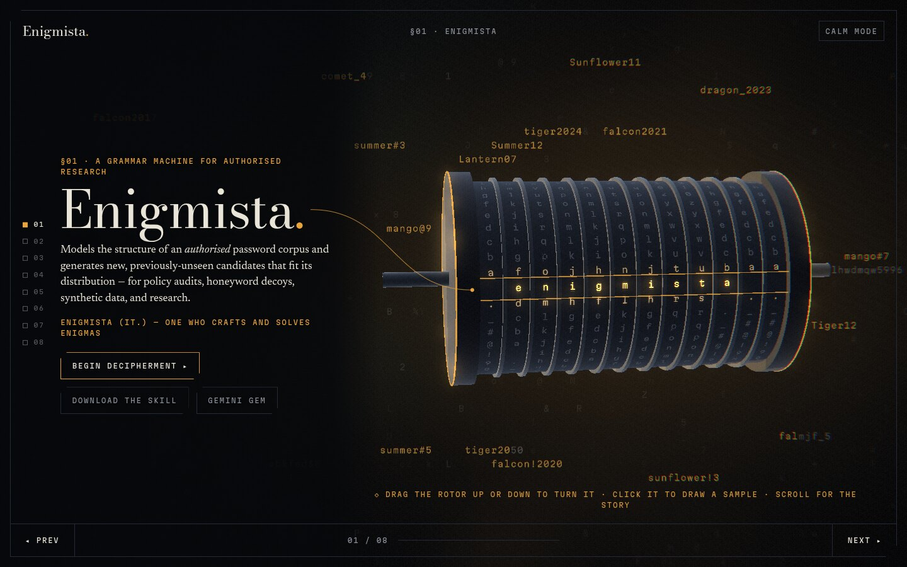<br><sub><b>01 · Enigmista.</b> The Rotor dials its own name; a tether ties the wordmark to the reading row.</sub></td>
    <td width="50%">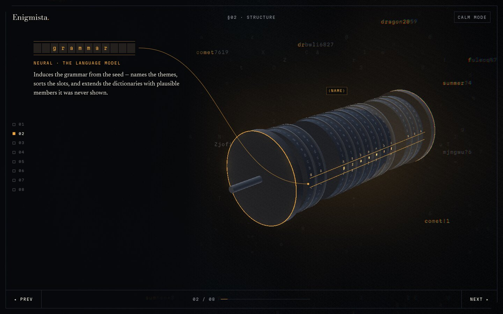<br><sub><b>02 · Structure.</b> Neural induction, symbolic sampling: the discs part along the grammar's slots.</sub></td>
  </tr>
  <tr>
    <td>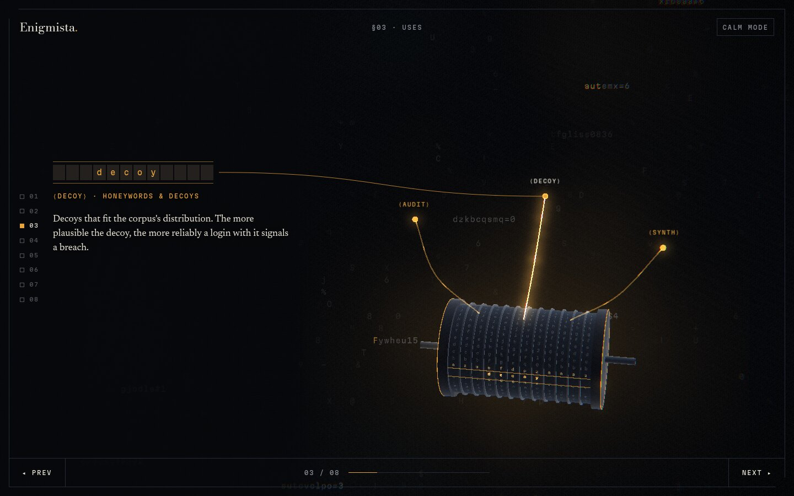<br><sub><b>03 · Uses.</b> Three branches, all defensive: ⟨audit⟩ ⟨decoy⟩ ⟨synth⟩.</sub></td>
    <td>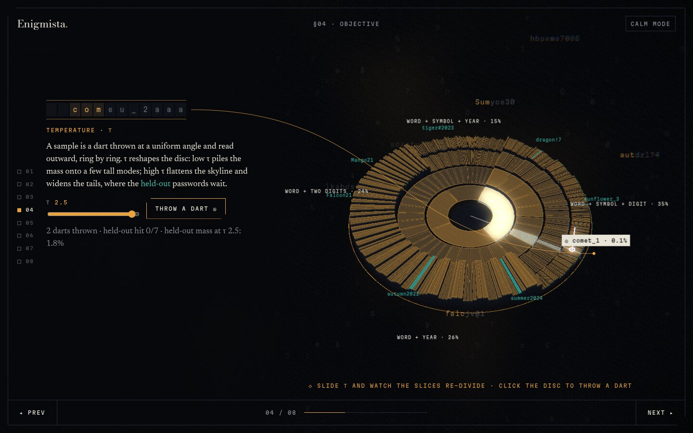<br><sub><b>04 · Objective.</b> The distribution in geometry: throw darts and turn τ (see below).</sub></td>
  </tr>
  <tr>
    <td>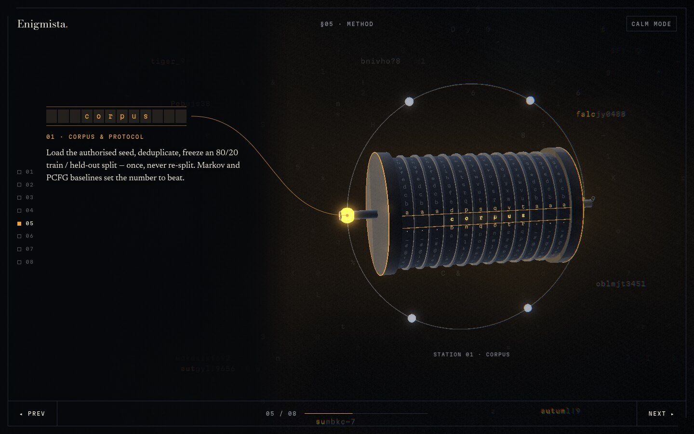<br><sub><b>05 · Method.</b> corpus → induce → sample → score → refine → stop, one station per beat.</sub></td>
    <td>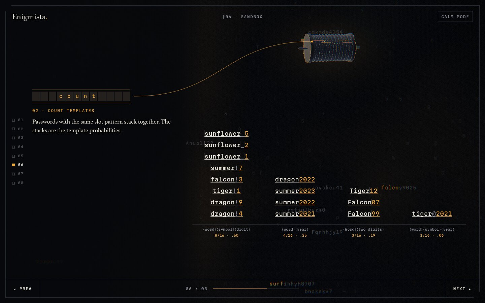<br><sub><b>06 · Sandbox.</b> A grammar induced live from sixteen obviously fake passwords.</sub></td>
  </tr>
  <tr>
    <td>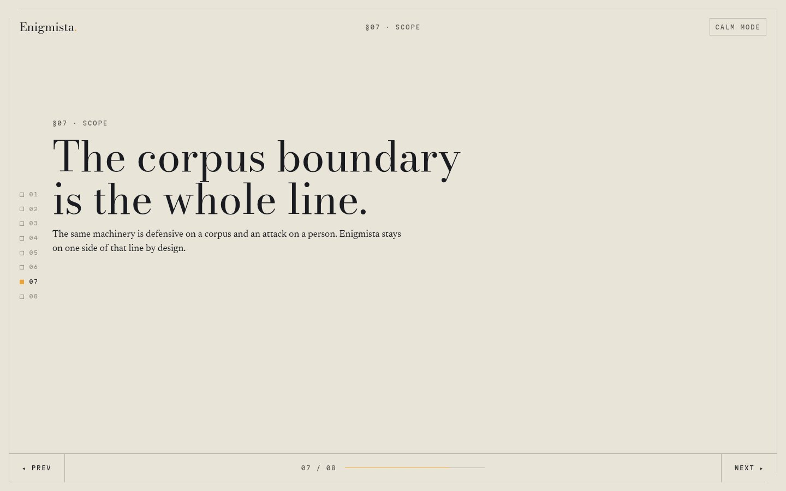<br><sub><b>07 · Scope.</b> The one paper page: the corpus boundary is the whole line.</sub></td>
    <td>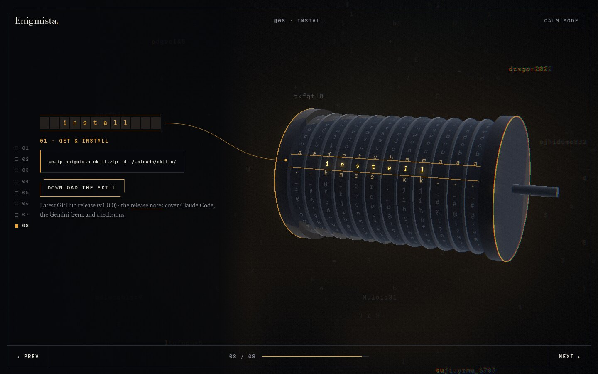<br><sub><b>08 · Install.</b> Download, smoke-test the scorer, bring an authorised corpus.</sub></td>
  </tr>
</table>

### The distribution, in geometry

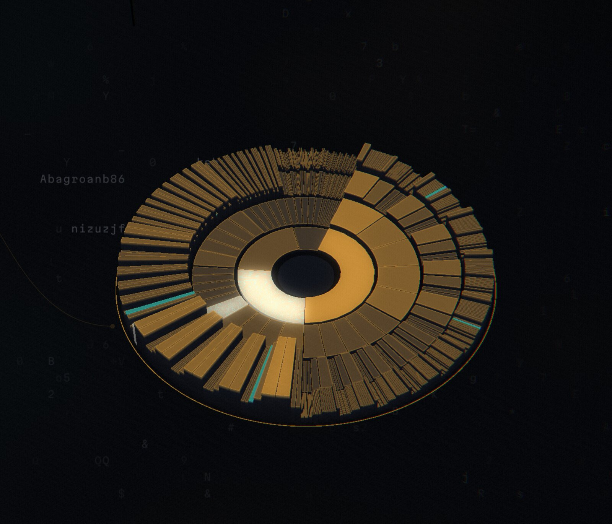

Below the drum lies what it draws from: the toy grammar as a disc of probability. The inner ring splits the circle by **template**. Each ring outward splits its slice by the next slot's **terms**, using the sampler's own tempered odds *p*<sup>1/τ</sup>, so a slice's angle *is* the chance a draw lands there. The towers on the rim are whole passwords, and the toy held-out ones stand in teal. A sample is a **dart** thrown at a uniform angle and read outward ring by ring: inverse-CDF sampling made literal. Slide **τ** and every slice re-divides live. Low τ piles the mass onto a few tall modes; high τ flattens the skyline and widens the tails, where the held-out passwords wait.

### On a phone

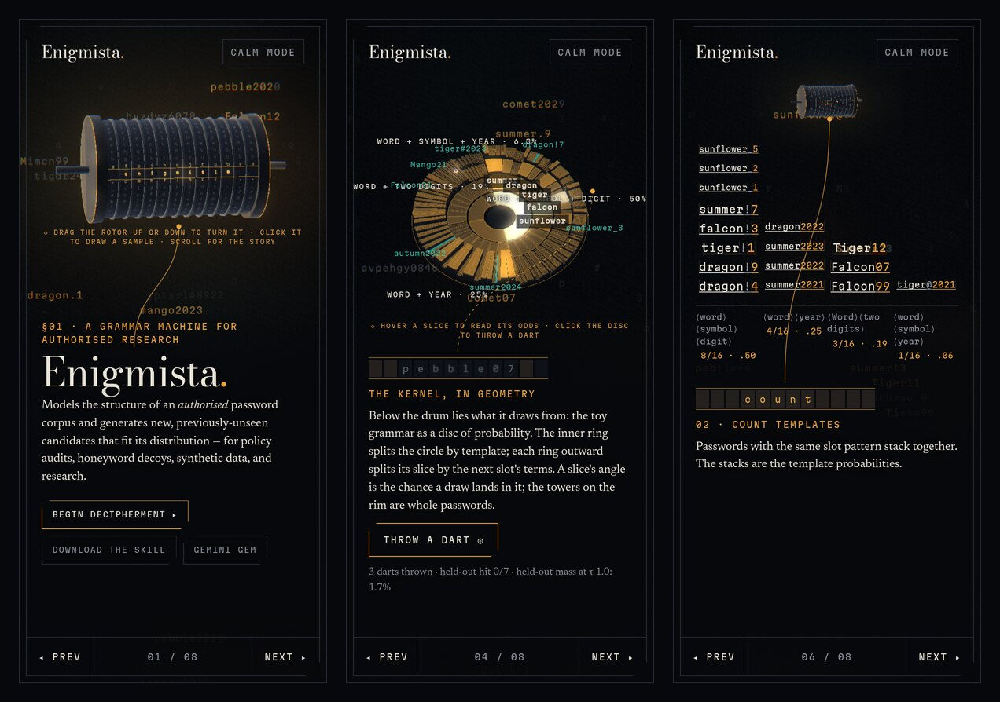

Every chapter keeps one composition: the visual in its frame, the caption in its own column (or below it on phones). Text and 3D never overlap, and a headless check (`scripts/check-site.mjs`) holds that across eight screen sizes.

## The demo contract

The sandbox exists to *illustrate* the method, nothing more:

- **Client-side only**, on a **bundled toy corpus** of sixteen invented passwords (`summer2021`, `dragon!4`, `sunflower_1`…) and seven toy held-out ones. Never a real list.
- **No text input**, anywhere. The build fails if a textarea, editable region or text field appears (`scripts/check-dist.mjs`). There's nowhere to type a password.
- Labelled **illustrative**: the inducer is a tiny character-class grammar, and the "enrichment" step is scripted. The real loop (scorer, held-out coverage, refinement) runs in the skill.

## Accessibility and privacy

- **Calm mode.** With `prefers-reduced-motion`, or one click on *Calm mode*, the film becomes a readable, scrolling document with no WebGL world and no animation loop. The check verifies 0 animation frames per second.
- **No analytics, no trackers, no third-party requests.** Fonts are self-hosted (Bodoni Moda, Newsreader, Martian Mono; all OFL).
- Real DOM text throughout: every caption is selectable, findable, and read by screen readers. The drum's readouts are decorative and hidden from assistive technology.
- Lighthouse accessibility, best practices and SEO: 96–100.

## How it's built

Vite · Three.js r186 · hand-written GLSL · static output on GitHub Pages.

| File | Role |
|---|---|
| `src/stage.js` | The film: a virtual playhead over beats (no native scroll), gesture gating, chapter flights, captions gated on the drum's lock |
| `src/world.js` | The Rotor and its set pieces; per-beat camera shots fitted exactly into the visual frame; readouts and tethers |
| `src/disc.js` | The probability disc: instanced sector prisms, tempered layout, darts, hover picking |
| `src/field.js` · `src/sampling-sim.js` | The background field: toy candidates scrambling and locking in glyph lanes, one draw call |
| `src/induce.js` · `src/induce-viz.js` | The toy inducer and the sandbox's full-frame induction animation |
| `src/post.js` | Glow, grain, vignette, edge chromatic aberration and a cipher-glitch on camera travel |
| `src/boot.js` | The preloader: nine rotor columns decipher ENIGMISTA as real loading steps complete |

## Develop

```bash
npm ci
npm run dev        # http://localhost:5173/enigmista/
npm run build      # vite build + scripts/check-dist.mjs (base path, .nojekyll, asset refs, no text inputs)
npm run preview    # serve dist at http://localhost:4173/enigmista/
```

Checks and tools (headless Chrome via `puppeteer-core`; set `CHROME_PATH` if Chrome isn't at `/usr/bin/google-chrome`):

```bash
node scripts/check-site.mjs [url]              # every beat × 8 viewports, paging walk, calm mode, no text inputs
node scripts/shoot.mjs <url> <dir> 1440x900    # screenshot every beat for review
node scripts/readme-assets.mjs [url]           # regenerate this README's banner, screenshots and social card
```

Append `?debug` to the URL for deterministic hooks: `__stage.beat(k)`, `__stage.jump(i)`, `__field.frames(n)`, `__field.world().debug()`.

Every push to `main` deploys to GitHub Pages through `.github/workflows/deploy.yml`, followed by a post-deploy smoke test. The site's social card (`public/og.jpg`) is the same image as [`.github/readme/social-preview.png`](.github/readme/social-preview.png), the repository's social preview.

## Licence

No licence has been chosen for this repository yet. The fonts are under the SIL Open Font License, and Three.js under MIT.
